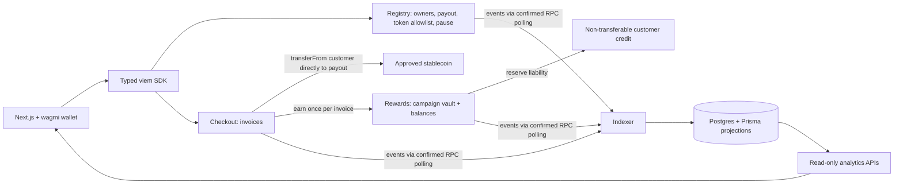
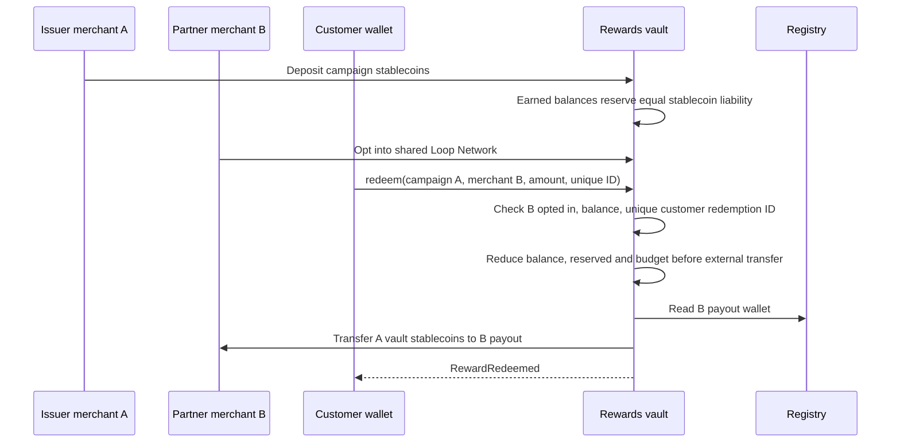

# Architecture and economic model



## Payment

```mermaid
sequenceDiagram
 participant M as Merchant
 participant W as Customer wallet
 participant C as Checkout
 participant T as Stablecoin
 participant L as Rewards
 M->>C: createInvoice(owner checked, approved token)
 M-->>W: Public invoice URL / QR
 W->>C: Read amount, expiry, current payout, campaign
 W->>T: approve(Checkout, exact amount) if necessary
 W->>C: payInvoice(id)
 C->>C: Validate open, token, expiry, pause; mark Paid
 C->>T: transferFrom(customer, merchant current payout, amount)
 C->>L: earn(invoice, campaign, customer, amount)
 L->>L: Reserve min(rate, customer cap, available budget)
 C-->>W: InvoicePaid log
 W->>W: Wait two confirmations; inspect matching receipt log
```

## Cross-merchant redemption



Each campaign uses one approved payment token. Its rewards use exactly that token’s base units; there is no floating point conversion or oracle. Multiple tokens are never summed by the intended single-token web deployment. Reward calculation uses OpenZeppelin `Math.mulDiv` to avoid multiplication overflow.

For each campaign, `0 <= reserved <= budget`. `budget` is funded assets minus redemptions minus unreserved withdrawals; `reserved` is cumulative earned minus redeemed. Available new earning is `budget - reserved`. Customer lifetime cap is cumulative earned and does not reset on redemption. Merchant B accepts the issuer’s token when opting into the shared network. Cross-token conversion is unsupported. B opts in independently; A need not remain a recipient partner for its issued credits to redeem elsewhere.

Earning is clipped to available funding and remaining cap; an exhausted/paused/out-of-window campaign does not block checkout. Campaigns are linked to the invoice merchant and token. Invoice IDs can earn once; redemptions have customer-scoped unique IDs. Campaign pause and end affect earning only. Protocol emergency pause suspends transactional flows, including redemption, until an authorized pauser resumes.

Campaign lifecycle is derived as Draft (before start), Active, Paused, Ended (at end timestamp), or permanently Closed. Owner-only close disables earning irrevocably. Only the merchant owner can withdraw a positive amount up to budget - reserved after end or closure, to a nonzero external recipient. Budget decreases before SafeERC20 transfer under a reentrancy guard. Operators have no refund or sweep authority. Refund remains available during emergency pause; redemption is temporarily paused globally. Credits never expire and remain redeemable after campaign end/close. New funding of ended/closed campaigns is rejected.

Reward policy can be selected atomically at creation: Open, QieIdVerified (disabled/fail closed), or Disabled. Owner/current-payout self-payment protection defaults on and is merchant configurable. Test invoices are permanently marked and never call earning. PaymentClassified records transaction-time policy eligibility separately from actual RewardEarned events. Linked wallets remain undetectable; see [anti-abuse](anti-abuse.md) and [identity gate](qie-id-integration.md). No protocol fee, customer-credit transfer or admin custody is introduced.

## Indexing and analytics

Polling works with a standard HTTP RPC, no paid indexer or websocket required. Index 500-block ranges from the first deployment block to `head - confirmations` (default 12). Sort/order follows RPC log order; logs are processed in order inside one DB transaction. Each raw event key is `chainId:txHash:logIndex`; a transaction writes raw events, projections and checkpoint atomically. A retry sees either all or none. A checkpoint includes the deployment-specific address tuple and canonical block hash.

Transient RPC/DB errors retry after five seconds, with viem transport retry inside each request. A checkpoint hash mismatch halts the process with an operator error; it never silently publishes a corrupted projection. Use the backed-up canonical journal replay procedure in [indexer recovery](indexer-recovery.md); rebuilding in the same database is supported with an explicit operator command. Run a single indexer instance per database. Deep reorg recovery is deliberately manual. Monitor checkpoint lag and process exit status.

Analytics use bigint token units: volume, payment count, unique/returning payer addresses, date-active campaigns, vault funds remaining, rewards earned, redemption count, and value-based redemption percentage. Wallet count is not person count. Projections and APIs are public read-only data, not payment authorization. Wallet balances and receipt status are checked on-chain. Metadata is JSON in the registry, validated before rendering and never interpreted as HTML. QR data contains only a public URL.

Withdrawals are projected independently. Funds remaining = funded - redeemed - withdrawn; outstanding liability = earned - redeemed; unreserved = funded - earned - withdrawn. Production aggregates exclude explicit tests and direct self-payments; gross aggregates retain them with labels. Policy eligibility does not imply a reward.
